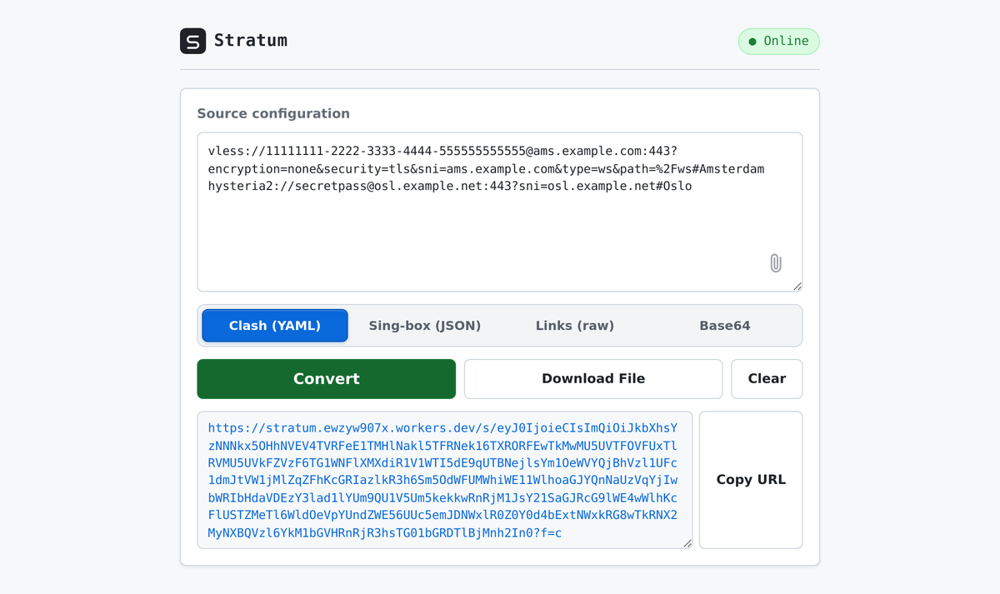
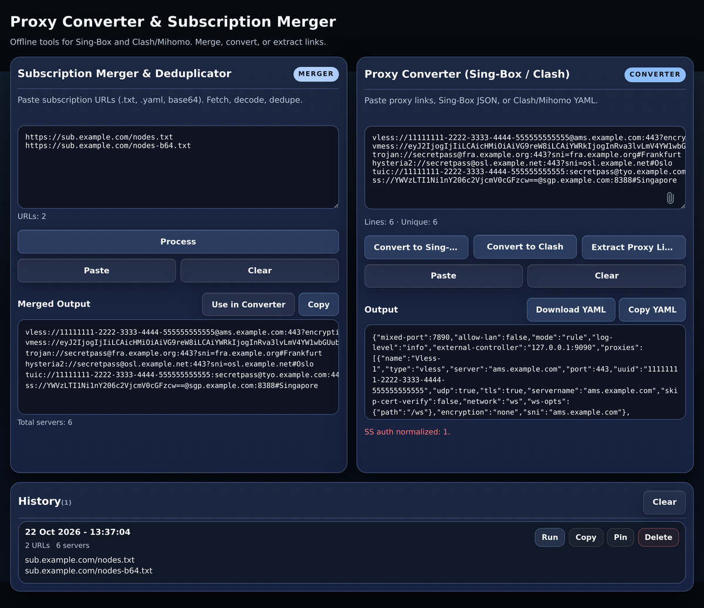

# Stratum

  

A Cloudflare Worker that converts proxy subscriptions between Clash / Mihomo
YAML, sing-box JSON, and raw share links. No database, no setup beyond one file.

`Stratum.html` in this repo is the same tool as one offline page. Open it in a
browser, nothing to deploy.

Demo : https://stratum.ewzyw907x.workers.dev/

## Setup

### Worker

1. Cloudflare dashboard → Workers & Pages → Create application → Start with Hello World! → Deploy.
2. Edit code: delete the template, paste all of `worker.js`, Deploy again.

### HTML file

Open the hosted copy at https://kaklaber.github.io/Stratum/Stratum.html, or
download `Stratum.html` and open it. Nothing to install, no server.

## Use

### Worker

Open the worker URL. Paste a subscription URL (or raw config text), pick a
format, press Convert. Put the generated link into your client
(Clash, Mihomo, v2rayNG, sing-box...).

- Your client shows the subscription name taken from the source URL.
- Refreshing the link always fetches the latest source — edits reach clients
  on their next update.
- Nothing is stored: the source travels inside the link itself, so longer
  sources make longer links.

### HTML file

  

One page, three panels:

- **Merger** takes subscription URLs, one per line, and gives back a single list
  with duplicates removed.
- **Converter** takes links or a config (Clash, sing-box, Xray, WireGuard) and
  writes it in another format.
- **History** keeps the last 10 merges in your browser. Any of them can go back
  into the Converter.

Your browser fetches the subscriptions here, so a host that blocks cross-origin
requests fails in the HTML file but works on the worker.

## Formats

In: links, base64 lists, Clash / Mihomo YAML, sing-box JSON, WireGuard `.conf`,
and in the HTML file also Xray JSON and bare shadowtls, anytls, naive and brook
links.

Out: Clash / Mihomo YAML, sing-box JSON, raw links (the worker also does
base64).
